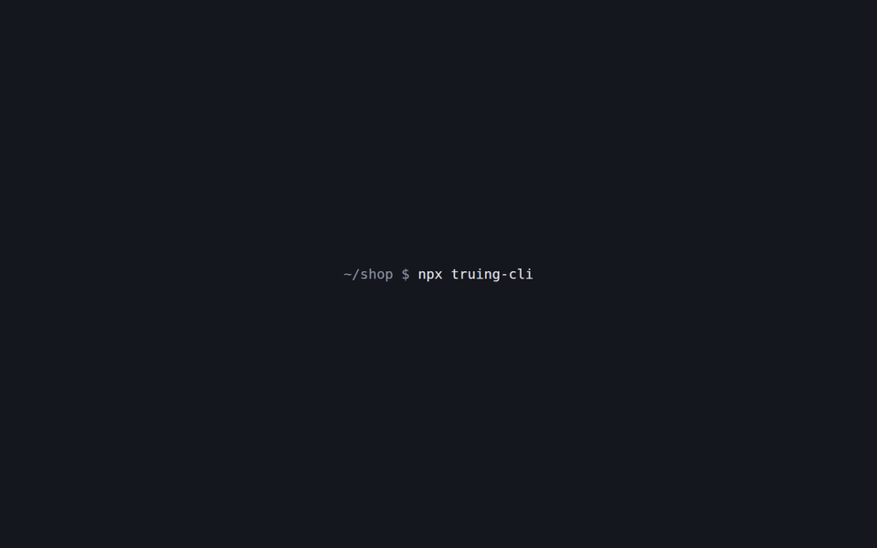

<h1 align="center">Truing</h1>

<p align="center">
  <strong>A design tool that works on your running app, not a mockup.</strong><br />
  Every change lands in your source code, ready for review. The code is the design.
</p>

<p align="center">
  <a href="LICENSE"></a>
  <a href="https://github.com/PedramRZM/truing/stargazers"></a>
</p>

<p align="center">
  
</p>

## The problem

Design and code drift apart. The design file says one thing and the app does another, and the gap closes one ticket at a time: a designer spots a wrong margin, files it, waits for a developer, checks it again. Coding agents have made this worse, because features now get built faster than anyone can polish them.

Truing flips the order. **A developer builds the feature first. A designer then refines the real thing**, in the running app, with the controls they already know. Each change is an edit to the source, so there's no design file to hand off and nothing to translate.

To _true_ a wheel is to make small, exact adjustments until it runs straight. Truing does that for a UI.

## Who it's for

- **Product designers** on teams with a code-based design system, who want to touch production UI without learning to code.
- **The developers** who review their work, and get ordinary diffs on tokens instead of a list of corrections.
- **Teams that care about design-system discipline.** Editing stays on your tokens, and the tool says so when it can't.

## How it works

- **It's your real app.** Truing opens its own Chromium window and frames your running app at real screen widths: phone, tablet and desktop, side by side. Your app needs no changes and ships none of Truing's code. There's no proxy: Truing injects itself from its own browser.
- **Click anything to see what it is.** Its component, its variant, the exact source location, the design tokens it uses, and every other place it's used.
- **Edit with designers' controls.** Panels with numbers, fonts and swatches, and a layers tree written for designers, with a Code view behind it.
- **Stay on the system.** Type any number: a value off your scale snaps to the nearest token and says so.
- **See how far a change reaches.** Each change shows whether it affects one use or every use of a shared component.
- **Review before anything is written.** Changes collect in a tray, each with its own undo, and apply in one of two ways:
  - **Direct.** Exact edits, like a token swap, text or a variant, go straight into the source with no AI.
  - **Through Claude.** Anything that needs judgement goes to Claude, on your own subscription, through the unmodified `claude` CLI you already have.
- **There's nothing to configure.** Claude reads how your project runs, and you confirm it once.

<table>
  <tr><td><strong>Inspect</strong></td><td>Pick any element to see its component, variant, call site, definition and tokens. See every other instance of it, with a count.</td></tr>
  <tr><td><strong>Edit</strong></td><td>Layout, spacing, type, colour, radius, borders, shadows and effects, from panels that offer your tokens. Edit text in place and switch variants.</td></tr>
  <tr><td><strong>See every size</strong></td><td>Phone, tablet, desktop and custom frames, and say whether a change applies at every size or from one size up.</td></tr>
  <tr><td><strong>Review</strong></td><td>A tray of changes labelled Direct or Claude. Apply writes them to your files, and you review them in git.</td></tr>
  <tr><td><strong>Ask Claude</strong></td><td>Chat with the selected elements attached. Keep or undo each answer as one step. Claude only writes the files you allowed.</td></tr>
</table>

### Not built yet

These are part of the design and on the [roadmap](docs/roadmap.md), but they don't work today:

- Sending your changes to the developer as a pull request. Today they land in your working tree, for you to commit.
- Flagging off-token values, and creating a missing token from the panel.
- Checking Claude's result at every screen size before you keep it.
- Teaching Claude new design rules by conversation.
- A performance monitor that hands its findings to Claude.
- A one-way token export so a Figma file can follow the code.

## What it is not

- **Not hosted or collaborative.** It runs locally, with no multiplayer.
- **Not for creating new screens from nothing.** It refines what already exists.
- **Not an AI app builder.** AI is one way to apply a change, and precise direct edits come first.
- **Not a Figma replacement for exploration.** Keep exploring wherever you like, and let the code be the source of truth.

Truing aims to feel precise, calm and dense: closer to a craftsperson's workbench than a playground. It respects the material, which is real code, and the system, which is your tokens.

## Quick start

From your project's folder:

```sh
npx truing-cli
```

You need [Node.js](https://nodejs.org) 20.19 or newer and [Claude Code](https://code.claude.com/docs/en/overview). The first run downloads Truing's own Chromium once. That's the whole setup.

## What happens the first time

1. **Connect Claude.** Truing checks three things for real: Claude Code is installed, you're signed in, and Claude answers a short question. If you aren't signed in, it starts Claude Code's own `claude auth login`.
2. **Choose a project.** The folder you're in, projects you've opened before, and folders you've worked in recently with Claude Code. You can also browse to any folder.
3. **Claude reads it.** With read-only tools, Claude works out the start command, the port, your components, your tokens and which files are UI. You watch what it reads. When the files don't settle something, it asks.
4. **You confirm, and it starts.** You see everything it found and where each value came from. Nothing runs until you press Start. Truing then runs the app and checks that it answers.

The next time, `npx truing-cli` opens your project straight away.

## What works where

| Your project                                           | What you get                                                                                                       |
| ------------------------------------------------------ | ------------------------------------------------------------------------------------------------------------------ |
| Next.js with React, Tailwind v4 and a token stylesheet | Everything                                                                                                         |
| Next.js with no Tailwind v4 tokens                     | Inspect, source locations, layers and Claude. Panels that need tokens have nothing to offer.                       |
| Another framework (Vite, Remix, Astro…)                | View the app at any size and work with Claude. Picking an element may not find its file yet. Setup tells you this. |

Truing is tested on Linux. macOS and Windows are on the [roadmap](docs/roadmap.md).

## Setup guides

### Install and sign in to Claude Code

```sh
npm install -g @anthropic-ai/claude-code
claude auth login
```

Truing uses whichever login Claude Code has. Check it with `truing doctor`. If you run Truing without signing in first, the setup screen offers the same sign-in. Finish it in the browser, and if Claude Code asks for a code, paste it in the terminal where you ran Truing.

An `ANTHROPIC_API_KEY` in your environment is not used today: sessions run on your Claude Code login, so a key can't run up charges by surprise. Sign-in by API key or a cloud provider is planned.

### Run it without typing the long command

```sh
npm install -g truing-cli
truing
```

Or add a script to your project: `"design": "npx truing-cli"`.

### Open a different project

```sh
truing ../other-project
```

Run `truing` from anywhere outside a project to get the project list.

### Ports

You don't set any.

- **Your app.** Claude traces the port from your scripts, config and framework defaults. If your dev server is already running, Truing uses it. If the server prints a different port when it starts, Truing follows it and remembers.
- **Another project on the same port.** Truing checks which folder the server belongs to. It won't attach to another project's server: it starts yours on a free port instead.
- **Truing's own server.** It asks the system for a free port, and two copies can run side by side.

### Monorepos

Claude lists the apps it finds and asks which one you mean, then reads again with your answer.

### When Claude got something wrong

Change it on the review screen before you start. To read the project again later:

```sh
truing --reconfigure
```

A value you changed yourself stays when Claude reads the project again, and the review screen shows what Claude read instead.

### Changing settings later

Everything setup confirms is in the **Settings** tab of the right panel, with Claude's reason beside each value. Change any of it there, or have Claude read one value again, without going through setup. What Truing and Claude may change takes effect right away. The rest applies the next time you open Truing, and the tab says so. A new start command needs your yes before it's saved.

Truing and Claude start out limited to your UI files. To let them change the whole project, choose **The whole project** on the review screen or in Settings. Tests, secret files, and Git's and Claude Code's own settings stay off limits either way, and Claude still never commits or pushes.

### Where settings live

Nothing goes in your repository. Truing saves one file per project in `~/.config/truing/projects/` (or `$XDG_CONFIG_HOME/truing`, or `$TRUING_HOME`), and each project's browser profile in `~/.cache/truing/`, so a sign-in to your app survives.

To keep settings in git instead, add an optional `truing.config.ts` at your project's root. It wins over the saved file, and it's also how you add your own modules. It's code, so Truing shows it to you and runs it only once you agree, and asks again if it changes. [`src/config.ts`](src/config.ts) lists the fields.

### Commands

| Command                                                    | What it does                                                                                                                 |
| ---------------------------------------------------------- | ---------------------------------------------------------------------------------------------------------------------------- |
| `truing [folder]`                                          | Open a project. The first time, set it up.                                                                                   |
| `truing --reconfigure`                                     | Let Claude read this project again.                                                                                          |
| `truing doctor`                                            | Check Claude Code and this project.                                                                                          |
| `truing setup`                                             | Report what Claude Code loads in this project. Writes a `CLAUDE.md` importing `AGENTS.md` if a project has only `AGENTS.md`. |
| `truing tokens [--stylesheet <file>] [--merge-out <file>]` | Print this project's tokens and where each comes from. Writes nothing unless you ask for tailwind-merge groups.              |

### Uninstall

```sh
npm uninstall -g truing
rm -rf ~/.config/truing ~/.cache/truing
```

## Privacy and security

- **Your Claude sign-in stays with Claude Code.** Truing runs the unmodified `claude` binary you installed. It never reads, stores, proxies or asks for a credential, and it has no login form.
- **Claude's usage counts against your own plan.** Reading a project is one Claude run. Truing has no account and no server of its own, and it sends no telemetry.
- **Reading is read-only, and stays in your project.** The project read uses only Read, Glob and Grep. A hook stops it leaving the folder, and `.env` files, keys and `secrets/` folders are denied. Your project's own hooks and MCP servers don't run during it.
- **Nothing a repository holds runs by itself.** Claude's answer is checked against the folder, and nothing of the project's runs until you confirm: not its start command, its Tailwind or a `truing.config.ts`. Read that command before you press Start, as you would before running a stranger's `npm start`.
- **Claude's edits are fenced.** A session can write only the files you allowed, enforced by a hook in every permission mode. Secrets are denied, and it can't commit or push.
- **Local only.** Truing's servers listen on loopback, check the `Host` header and require a per-session token.

To report a vulnerability, see [SECURITY.md](SECURITY.md).

Truing is an independent project, not made by or affiliated with Anthropic. Claude and Claude Code are Anthropic's. Your use of them is under [Anthropic's terms](https://code.claude.com/docs/en/legal-and-compliance), so check that your plan covers how you use Truing.

## Modules: plug in a feature

Every feature of Truing is a module, the ones it ships with included: `selection` (inspecting and the design panels), `changes` (the tray), `claude-config` (what Claude loads) and `claude` (the chat). Truing's core knows none of them by name, so a module of yours gets the same seams they do, and adding one needs no change to the core. Nothing needs configuring unless you add one.

A module has up to four parts. Each runs in a different place, so each gets its own file, and only `module.ts` is required:

| File        | Runs in                                         | What it's for                                                             |
| ----------- | ----------------------------------------------- | ------------------------------------------------------------------------- |
| `module.ts` | everywhere                                      | Declares the module and, as schemas, what its parts send each other       |
| `probe.ts`  | every frame of your app, before the page's code | Looks at the page: reports what it sees and answers commands              |
| `panel.tsx` | Truing's shell                                  | A section in the left or right panel, plus keys and context-menu commands |
| `server.ts` | Truing's Node process                           | Reads and writes files, stages changes, and gives Claude tools            |

**Plugging one in** means listing it, in the order its section should appear, and restarting. A module of your own is the one thing Truing can't work out by reading your project, so this is where you'd need a `truing.config.ts`. Today that file replaces the profile Claude saved rather than adding to it, so it has to carry the settings too. [`src/config.ts`](src/config.ts) lists them all:

```ts
export default {
  name: 'my-app',
  app: { devCommand: 'pnpm dev' },
  writable: { include: ['src/**'], exclude: [] },
  modules: [
    'selection', // a bare name: one that ships with Truing
    'changes',
    'claude-config',
    'claude',
    './truing/modules/element-count', // a path from your project's root: your own
  ],
};
```

**Pulling it out** means deleting the line. Its probe, panel, server handlers and Claude tools go with it, and nothing is left behind in your app, since modules run from Truing's browser and process.

**A module that fails stops alone.** If its probe throws, its listeners are removed in that frame and its section says so. If its panel throws, the section shows the error. If its server fails to start, its tools aren't registered. The rest of Truing keeps working.

[`examples/element-count`](examples/element-count) is a complete module in about 150 lines: it counts the elements in each frame, shows the counts in a panel, and gives Claude a tool to ask for one. [`docs/modules.md`](docs/modules.md) walks through building it.

## Roadmap

- **v0.1, zero-config foundation:** this release.
- **v0.2, everyone can install it:** `npx truing-cli` from npm, macOS, a Vite adapter, tokens read through Claude for projects not on Tailwind v4, and noticing when a project's setup has changed.
- **v0.3, design system round trip:** create and lint tokens, flag what's off-token, let Claude apply what the panels can't, and hand changes back as a pull request that follows your project's own conventions.
- **v1.0, team ready:** a board of pages, several takes side by side, a component gallery, drag to reorder, performance tools, and shared team settings for those who want them.

The details are in [`docs/roadmap.md`](docs/roadmap.md), and every task is in [`backlog/`](backlog/).

## Contributing

Contributions are welcome. Start with [CONTRIBUTING.md](CONTRIBUTING.md). The short version: `pnpm install`, `make setup`, `make check`. The repository works the same way with Claude Code and other coding agents, and [AGENTS.md](AGENTS.md) is the map. The one rule that shapes everything: a feature must never need a config file or a hard-coded path, port, framework or token location.

## Stargazers

If Truing saves you a round of design tickets, a star helps others find it.

<a href="https://star-history.com/#PedramRZM/truing&Date">
  <picture>
    <source media="(prefers-color-scheme: dark)" srcset="https://api.star-history.com/svg?repos=PedramRZM/truing&type=Date&theme=dark" />
    <source media="(prefers-color-scheme: light)" srcset="https://api.star-history.com/svg?repos=PedramRZM/truing&type=Date" />
    
  </picture>
</a>

[](https://github.com/PedramRZM/truing/stargazers)

## Licence

[MIT](LICENSE). Vendored files and fonts keep their own licences, listed in [THIRD_PARTY_NOTICES.md](THIRD_PARTY_NOTICES.md).
